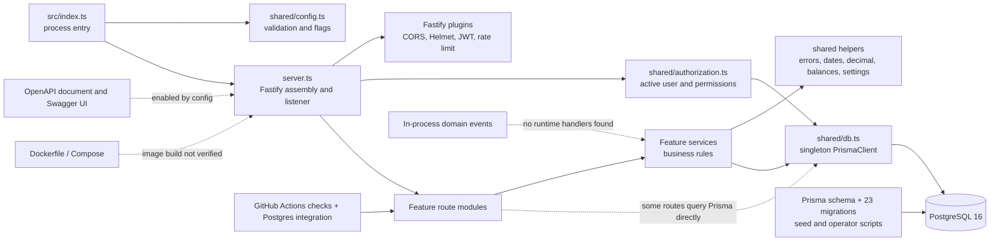

# Backend architecture

## Architectural shape

The backend is a single deployable, single-process Fastify API backed by one
PostgreSQL database through one Prisma client. The code is organized as a
feature-oriented modular monolith. Route modules define HTTP contracts and
call feature services; feature services implement most business decisions and
perform persistence through Prisma. The repository does not contain a
cross-cutting repository/DAO layer, explicit dependency-injection container,
separate domain package, or independently deployable module boundary.

This matches the broad “modular monolith” description in
[`afrinov-platform/README.md`](../../../afrinov-platform/README.md), but the
module boundaries are conventions rather than enforced build boundaries.
Business and infrastructure concerns are mixed within some feature services,
and a few route modules issue Prisma queries directly for response/export
support. The architecture diagram marks these as direct dependencies rather
than implying a strict layered design.

## Runtime boundaries and ownership

| Boundary | Responsibilities | Dependencies |
| --- | --- | --- |
| Process bootstrap | Fatal process hooks, fail-fast configuration, start orchestration | `shared/config`, `server` |
| Fastify application | HTTP listener, parser/hooks, CORS, headers, JWT, rate limiting, error translation, health and API route mounting | Fastify plugins, shared config, singleton Prisma |
| Identity/security | Login, account records, JWT verification, active-account revalidation, DB-backed permissions | Prisma, bcryptjs, `@fastify/jwt`, shared errors/permissions |
| Feature modules | Inventory, procurement, operations, reporting, settings, audit | Shared helpers and direct Prisma queries/transactions |
| Persistence | PostgreSQL schema, foreign keys/unique/index constraints, migration history | Prisma Client and SQL migrations |
| Operator scripts | Seed, migration, diagnostic, import/transform commands | Prisma Client and environment-provided DB URL |
| Test harnesses | Mock-backed unit tests and separate real-HTTP/Postgres tests | Vitest, Fastify inject/socket, PostgreSQL for integration |

No external runtime integration was found. The domain-event dispatcher is an
in-process synchronous utility; repository search found registrations in its
tests but no handler registration in runtime source. There is no durable event
delivery or retry boundary.

## Dependency direction

The primary dependency path is:

```text
src/index.ts
  -> src/shared/config.ts
  -> src/server.ts
       -> Fastify plugins and shared middleware/security
       -> modules/*/*.routes.ts
            -> modules/*/*.service.ts (where present)
                 -> shared helpers + shared/db.ts -> Prisma -> PostgreSQL
       -> src/openapi/document.ts (only when API docs are enabled)
```

Some route modules call a Prisma model directly in addition to invoking
services. Services share helper functions across features, especially
inventory and settings. The Prisma schema is the persistence source of truth;
there is no generated repository layer between the service methods and the
client.



Dashed edges mean conditional, partial, or unverified relationships. The CI
workflow's existence is confirmed; the image build and real-Postgres job were
not run in this environment.

## Module inventory

The module names mounted by `server.ts` are `identity`, `inventory`,
`procurement`, `operations`, `reporting`, `settings`, `audit`, and `health`.
`migration` contains file/workbook helpers but is not mounted as an HTTP
module. Procurement route registration is conditional: purchase-order and
goods-receipt endpoints are omitted when `PROCUREMENT_ENABLED=false`; supplier
routes remain registered.

| Module | Main ownership | Cross-module/data coupling |
| --- | --- | --- |
| `identity` | Login, users, roles | Shared DB, role/permission records, authentication hook |
| `inventory` | Materials, locations, stock movement ledger, counts, tools | Shared balances/status helpers; references users, recipients, projects, suppliers and receipts |
| `procurement` | Suppliers, POs, approvals, goods receipts | Creates inventory movements when receipt is posted; shared inventory logic and settings |
| `operations` | Projects and recipients | Inventory movement validation and reporting references |
| `reporting` | Current stock, movement, value, consumption, month-end, exports | Queries across inventory, project, procurement, settings and identity tables |
| `settings` | Typed settings, defaults, cache | Used by inventory, procurement and reports |
| `audit` | Audit and activity reads | Feature writes persist audit rows through Prisma |
| `health` | API-prefixed liveness/readiness | Prisma connectivity probe |
| `migration` | Workbook reading, analysis, mapping, reconciliation and opening balances | Operator scripts and direct DB imports; no API route boundary |

## Persistence and cross-cutting behavior

Prisma is both the runtime data-access client and migration tooling. Feature
services call Prisma models directly. The inventory ledger is the source of
truth; balance rows are recomputed from ledger aggregates after mutations.
Audit rows and most multi-row changes are written by feature services, but
the schema alone does not enforce business invariants such as no negative
stock. See [persistence behavior](../data/persistence-and-database-lifecycle.md).

Cross-cutting request behavior lives mainly in `server.ts`: request IDs,
Fastify/Pino request logging, CORS, Helmet security headers, JWT verification,
rate limiting, response error mapping, and health probes. There is no
metrics/tracing/error-reporting integration. See the
[security model](../security/authentication-and-security-model.md) and
[request lifecycle](request-lifecycle.md).

## Architecture concerns and drift

- The package is a modular monolith but boundaries are folder/import
  conventions only; reporting and some route support code span feature data.
- Direct Prisma access in routes and services makes the persistence boundary
  explicit but distributed. Changes to schema/client affect many modules.
- Runtime domain events are synchronous and have no discovered production
  handler registrations; they do not provide durable integration delivery.
- Health routes exist both at `/health` and `/api/v1/health` (with matching
  readiness route) because infrastructure and frontend callers use different
  base paths.
- Intended architecture docs describe desired principles and bounded contexts;
  code grouping only partially enforces them. Treat ADRs as intent, not proof
  that deployment or data integrity controls are implemented.
- The Dockerfile, build context, test database isolation, and backend CI Node
  version were corrected in the follow-up. Docker and CI execution remain
  unverified. See the [readiness audit](../audits/backend-understanding-and-readiness-audit.md).

## Verified versus unverified

**Verified from source:** one Fastify process, lazy route imports from
`server.ts`, one Prisma singleton, PostgreSQL schema/migrations, module routes,
security plugins, and transaction-based inventory writes.

**Observed by local execution:** the compiled entry starts with an unreachable
dummy PostgreSQL target; `/health` returns 200 and `/health/ready` returns 503.

**Not verified:** remote integrations (none configured), production deployment,
image build, live schema/migration compatibility, concurrency invariants,
real-HTTP integration suite, backup/restore, and container startup.
